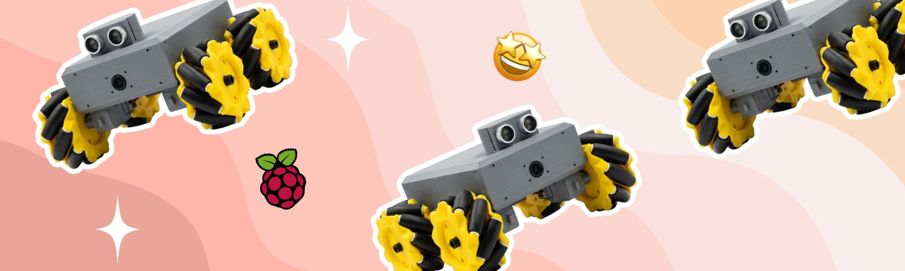
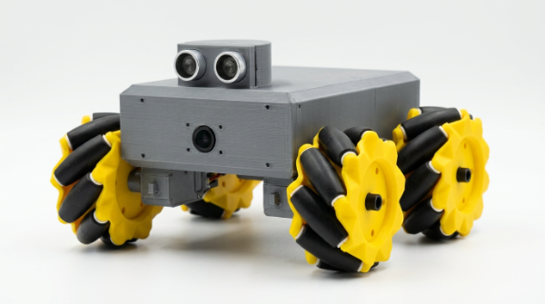

# rover

Welcome to Rover! Rover is a simple object tracking vehicle that uses a Raspberry Pi running object detection models. Rover can also be used in a manual control mode, where you can drive it through a Flask web app and see first person footage from the camera on the body. Rover uses 3D printed parts for the chassis. I created this project because I wanted to add a unique twist to the classic obstacle-avoiding rover project. This version brings actual intelligence to the rover, and the ultrasonic sensor is now being used to make sure the rover doesn't hit anything while it's following an object.

The footprint of Rover is approximately 192mm x 192mm x 110 mm.

## Navigating this repo

- For **images** and to see a 3D model, scroll below.
- To get the **code** for the rover, go to the /rover-code folder.
- To access the files for **3D printing**, go in /models and download the file format you want that starts with "print-" (there's a rover-model.step that isn't for printing).
- **Instructions** for setting up the rover will be in [instructions.md](./instructions.md).
- To see my **thought process** in working on this project, go to /journals.
- The **bill of materials** is at [bill-of-materials.csv](./bill-of-materials.csv).
- The **wiring diagram** is at [wiring-diagram.png](./wiring-diagram.png)

## Details

### Images

| Front                                                                                      | Back                                                                                       | Top                                                                                        | Bottom                                                                                     | Inside                                                                                     |
| ------------------------------------------------------------------------------------------ | ------------------------------------------------------------------------------------------ | ------------------------------------------------------------------------------------------ | ------------------------------------------------------------------------------------------ | ------------------------------------------------------------------------------------------ |
|  |  |  |  |  |

*Important note about images: the camera module in these pictures is a different one than the one listed in the Bill of Materials, reason being that I couldn't find the right model.*

To view an online-hosted 360 degree view of this robot, click [here](https://viewer.autodesk.com/id/dXJuOmFkc2sub2JqZWN0czpvcy5vYmplY3Q6YTM2MHZpZXdlci1wcm90ZWN0ZWQvdDE3ODYxMzAxMDFfZWQ1MWQwMjQtYmZkZC00ODYwLTlhMmEtNWNkMTA2MTk2NTlkLnN0ZXA?sheetId=MDg1ZTA2MzItN2NhZS00OWVhLThhOTYtMDhkMjE2MTU4ZDQ1). The same file is in the /models folder ([here](./models/rover-model.step)). If the online-hosted link expires for any reason, please let me know by opening an issue request.

### Instructions

Please go to the dedicated [instructions.md](./instructions.md) file to see instructions.

### More stuff

AI generated image of the rover, note that the motors on the bottom look 3d printed, which is inaccurate.
