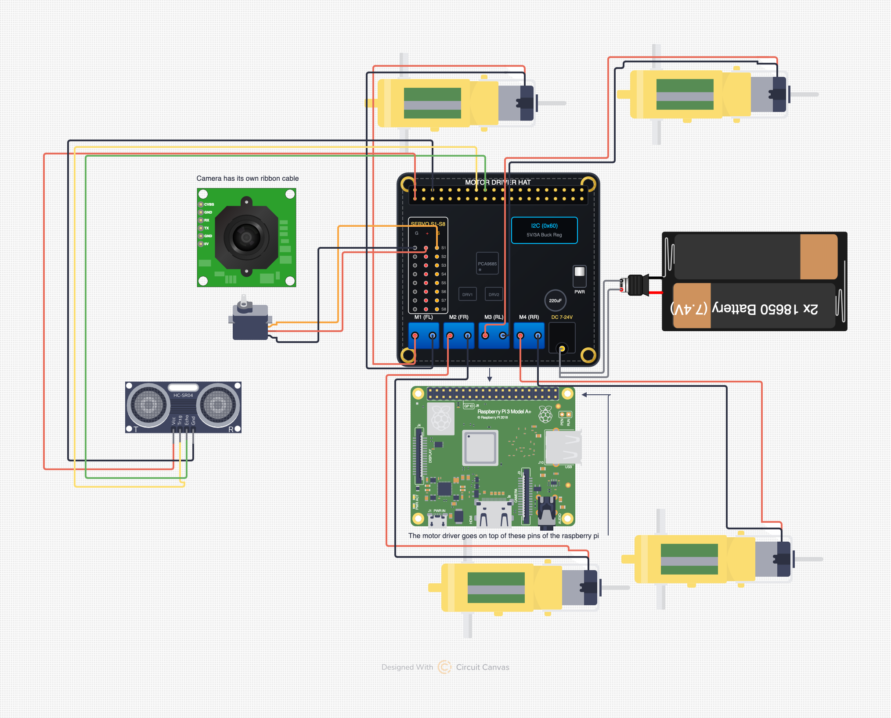

# Instructions

### Wiring

1. Mount the Raspberry Pi to the body
2. Mount the DFRobot HAT on top of the Raspberry Pi 3A+.
3. Connect the motor wires and mount the motors on the body
4. Mount the mecanum wheels on the motors (in an X formation)
5. Connect the 3 wire connector of the SG90 to the S1 header on the HAT
6. Mount the SG90 on the bod
7. Mount the ultrasonic sensor on the servo mount, and connect the 4 wires to the Pi Header
8. Connect the camera to the Pi's camera port
9. Mount the camera
10. Put both batteries in the battery holder
11. Plug in the the DC barrel from the battery holder in the power input on the HAT

### OS Config

1. Boot the pi
2. Open terminal and run "sudo raspi-config"
3. Enable I2C and Camera
4. Exit and run "sudo reboot"

### Software and libraries

1. Run "sudo apt update"
2. Install python3-pip python3-opencv python3-flask python3-rpi.gpio python3-smbus python3-pil i2c-tools
3. Copy code files into a folder
4. Clone the DFRobot Motor driver library by running "git clone [https://github.com/DFRobot/DFRobot\_RaspberryPi\_Motor.git](https://github.com/DFRobot/DFRobot%5C_RaspberryPi%5C_Motor.git)"

### Running the code

1. To run autonomous mode, run object_tracking.py
2. To run maual mode, run manual_control.py
