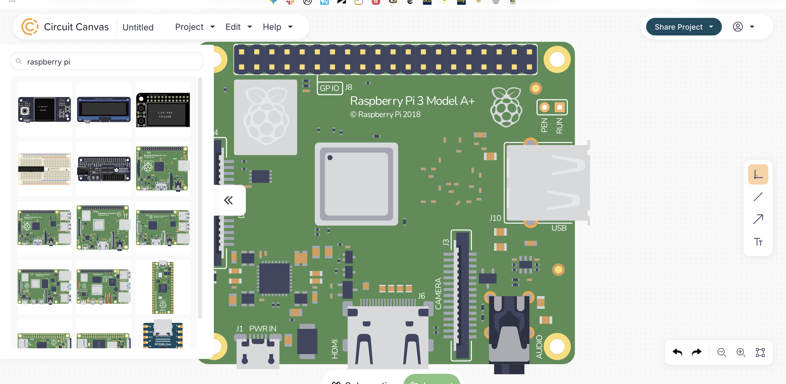
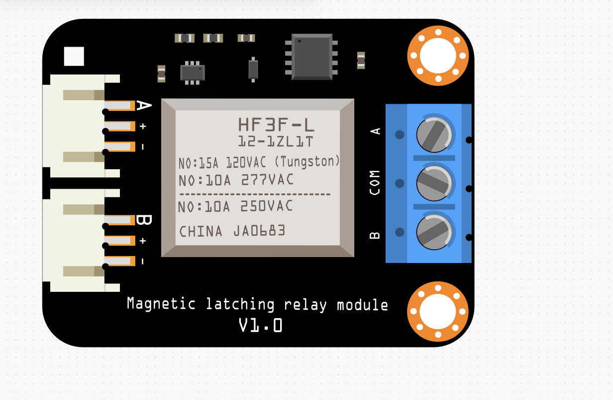
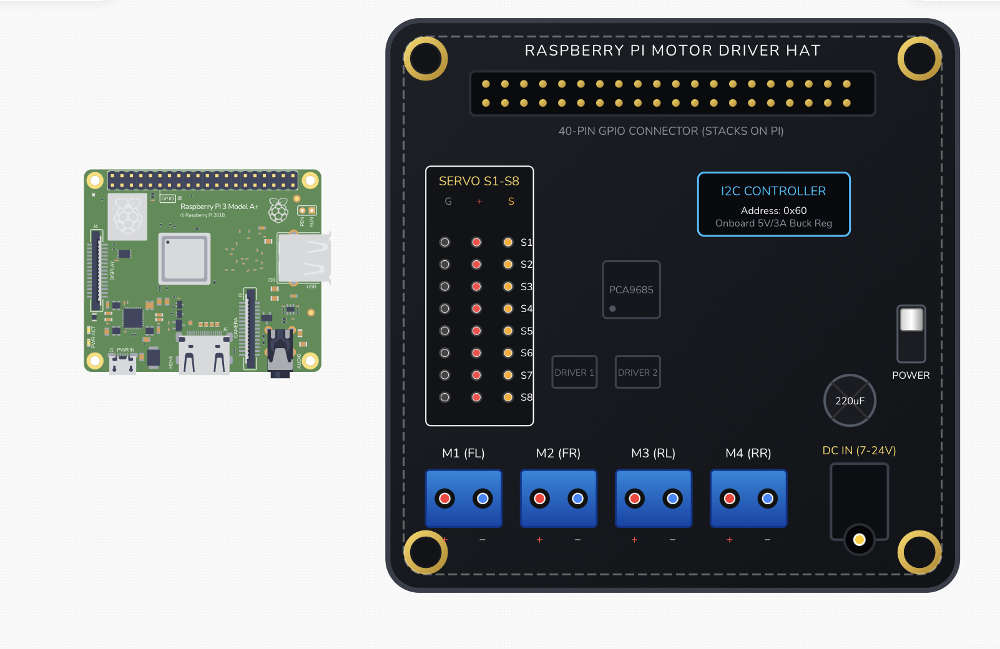
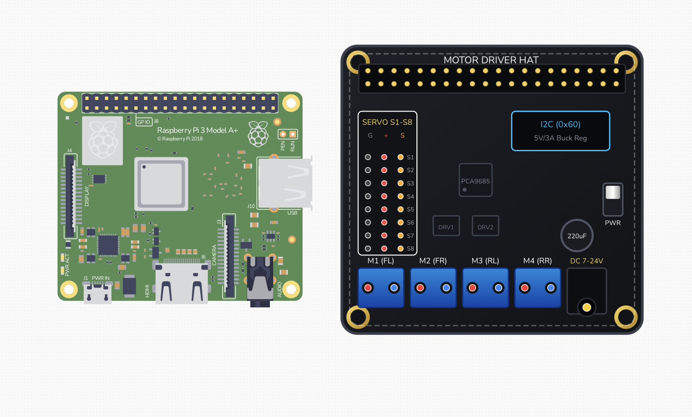
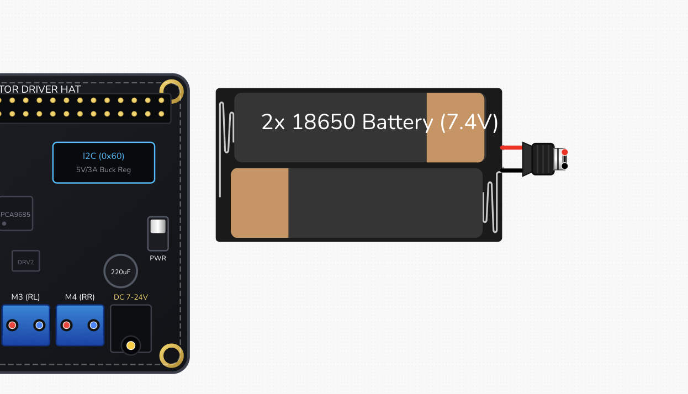
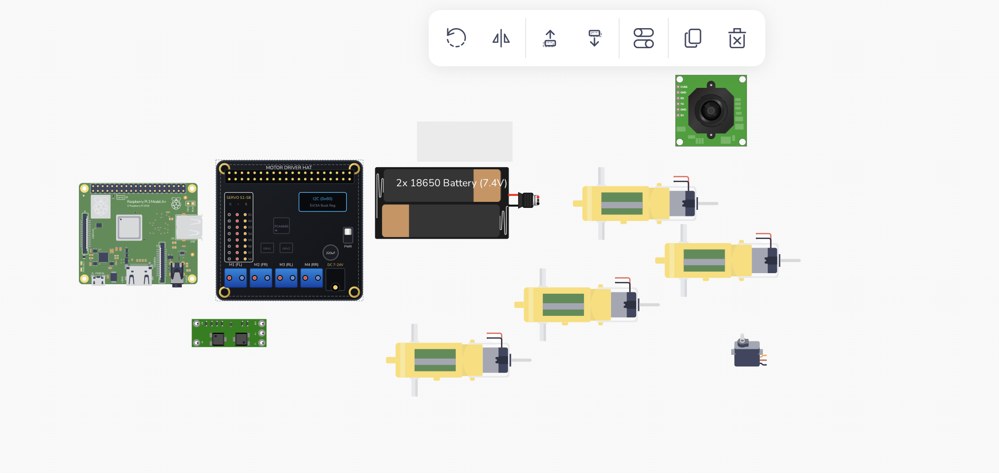
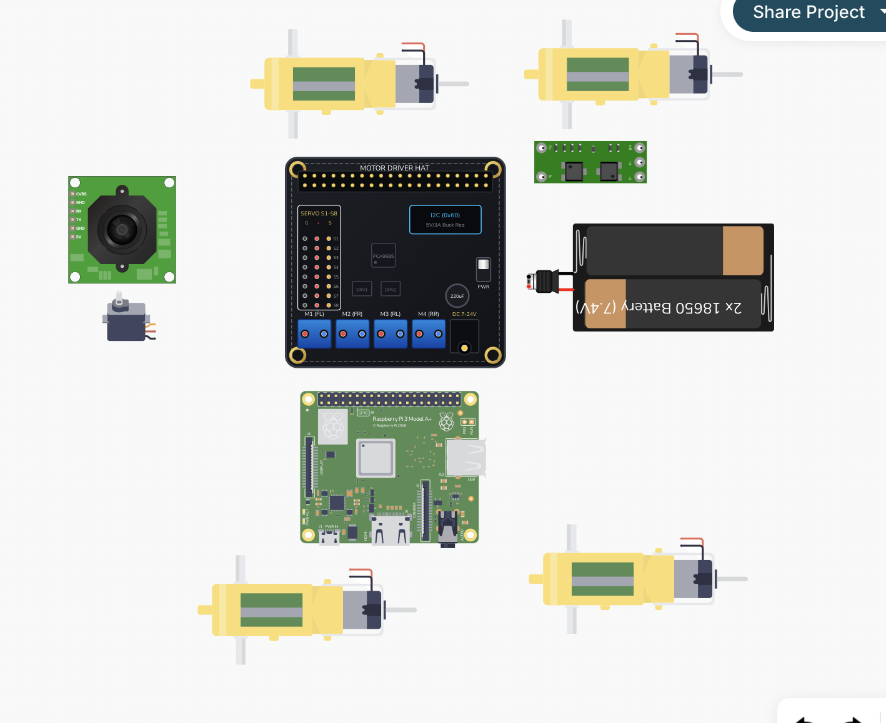
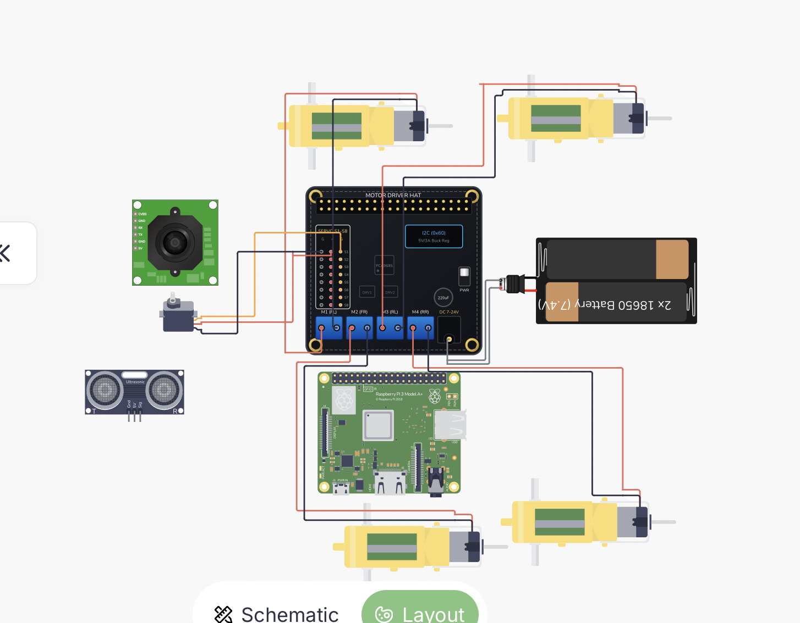

After a 1 day break, I am ready to jump into the next section of this project

We're going into electronics. First I want to finalize the BOM before we move to this stage, and confirm that everything should fit together without last minute addons (though that's unavoidable).

FINALIZED BOM:

1. 4 80mm mecanum wheels - [https://www.aliexpress.us/item/3256804929248374.html](https://www.aliexpress.us/item/3256804929248374.html)
2. 4 1:220 TT Motors - [https://www.aliexpress.us/item/3256808093084021.html](https://www.aliexpress.us/item/3256808093084021.html)
3. Ultrasonic sensor (3.3v compatible) - [https://www.aliexpress.us/item/3256812540803651.html](https://www.aliexpress.us/item/3256812540803651.html)
4. Raspberry Pi 3 Model A+ - [https://www.adafruit.com/product/4027](https://www.adafruit.com/product/4027)
5. DF Robot Motor Driver Expansion Board - [https://www.aliexpress.us/item/3256807075492551.html](https://www.aliexpress.us/item/3256807075492551.html)
6. M2.5 spacers kit + M2.5 6mm Screws - [https://www.aliexpress.us/item/3256807311842711.html](https://www.aliexpress.us/item/3256807311842711.html)
7. Wide-lens camera module (color I 130) - [https://www.aliexpress.us/item/2251832482194239.html](https://www.aliexpress.us/item/2251832482194239.html) 
8. SG90 servo motor (for lidar sensor) - [https://www.aliexpress.us/item/3256806097043668.html](https://www.aliexpress.us/item/3256806097043668.html)
9. Samsung 25R 18650 2500mAh 20A Battery x 2 -  [https://www.18650batterystore.com/products/samsung-25r-18650?_pos=1&_sid=a19e8e6a9&_ss=r](https://www.18650batterystore.com/products/samsung-25r-18650?_pos=1&_sid=a19e8e6a9&_ss=r)
10. 2x18650 Battery Storage Box 7.4V - [https://www.aliexpress.us/item/3256811664143308.html](https://www.aliexpress.us/item/3256811664143308.html)
11. M2.5 screws (m2.5 x 12mm and m2 x 4mm I already have m2 screws that are 4mm long so that's fine for me) - [https://www.aliexpress.us/item/3256808523663879.html](https://www.aliexpress.us/item/3256808523663879.html)
12. Dupont cables (F-M 40 cm, 20 pack, also F-F but I already have that) - [https://www.aliexpress.us/item/3256804460701476.html](https://www.aliexpress.us/item/3256804460701476.html)
13. 2S 8A BMS board (2S 8A-15A Green) - [https://www.aliexpress.us/item/3256805855172022.html](https://www.aliexpress.us/item/3256805855172022.html)
14. Battery charger (2 slots) - [https://www.aliexpress.us/item/3256806967255191.html](https://www.aliexpress.us/item/3256806967255191.html)

I added F-M dupont cables and i don't need F-F cables since I already have them. I'm going to take another look at the batteries and the motor and wheel combo. The motor is rated for 6V so I will just restrict the pusle width modulation of that in the motor driver. The wheels will fit on the motors.

I don't like the batteries though so I'm going to see if I can find a better one. Hmm... The batteries are unprotected, which is not good. I need to get protected batteries, but they won't fit in the battery holder since protected batteries have a different overall footprint.

I found a legit looking battery store that sells Samsung brand batteries [https://www.18650batterystore.com/products/samsung-25r-18650?_pos=1&_sid=a19e8e6a9&_ss=r](https://www.18650batterystore.com/products/samsung-25r-18650?_pos=1&_sid=a19e8e6a9&_ss=r). This one is called Samsung 25R 18650 2500mAh 20A Battery. They don't have free shipping, but with two batteries, the subtotal is only $10 and with $7 shipping is roughly $6 more than the Aliexpress one. If shipping isn't covered with grants, I'll pay for shipping out of pocket. To protect the batteries I'm going to be adding a 2S 8A BMS board. [https://www.aliexpress.us/item/3256805855172022.html](https://www.aliexpress.us/item/3256805855172022.html)

is pretty good, I will get the type 2S 8A-15A Green. Actually it doesn't have free shipping. All of them actually seem to have free shipping over $10 only. We'll see how it works when I go to checkout. Let's add everything to the cart and see what it adds up to.

Adding everything to cart is a lot more complex than expected. First of all, for some items aliexpress is making me choose other items with it. Second, I couldn't find spacers only for the M2.5, only a kit with spacers AND screws. I had to add the kit, and STILL have to get M2.5 screws separately because I'm getting the 12mm variant which isn't in the kit.

45 Min checkpoint

Okay for Aliexpress, it's charging me $6.13 for shipping.  Eh. Total is $68 but that's before other coupon codes (they have some summer coupon discount thing). On the second storefront (DFRobot), they are adding $6 for shipping. If Aliexpress offers free shipping, I'm purchasing the Aliexpress version. Yes it does, so we are using Aliexpress version (cost ends up being the same at the end). Third (now second) storefront is the 18650 battery store. They are chargins $18 total ($7.41 shipping). The cost of this entire rover costs ~$123. Not bad, but that's with not counting the printed parts (shipping for that). Okay.

Now, let's move to the electronics. I'm going to use Tinkercad circuits. Great, I forgot my password. Logged in now. Hmm. I can't find the exact motor driver. Okay, I'll just use a different software for this. I found something called circuit canvas. It seems cool.

To import the motor driver, I'm going to the DFrobot website and looking for the top down image of it. Okay, I found it. Okay I can't upload images. However, I saw that I can upload Fritzing parts, and after a quick search, I found a user in Fritzing forums requesting a Fritzing file for the exact motor driver! [https://forum.fritzing.org/t/looking-for-df-robot-motor-driver-board-dfr0592-and-lvdt/28109/8](https://forum.fritzing.org/t/looking-for-df-robot-motor-driver-board-dfr0592-and-lvdt/28109/8)

Huh, this doesn't look like it. Ah it's a different motor driver. That sucks. Let me search again. No results. DFrobot has a pdf schematic, so let me see if I can use that. No, it only seems like they want SVG or Fritzing parts. Let's see if I can use AI to make the SVG for me. I sent the images and schematic PDF. Okay it's done. It's pretty good. I sent the documentation now of how to specify pins for circuit canvas and it made an updated version.

It's too big. Apparently 2.5x too big.

Here's the fixed one:

Found 2S BMS Board from the forum of Fritzing, and added a 2xAA battery holder (wait I need to fix that). Again I found a battery holder and it still doesn't ouput in dc plug. Let me go back to the aliexpress listing to see what it's called. Okay still no results. The thing is, for this battery holder, there is a version in the forums, but it doens't have a dc output. I gave AI the file and told it to add that (it should be simple).

Okay, that's pretty good. I added motors and now I am looking for the camera. I'm going back to the Aliexpress listing for the camera. Alright I found the fritzing file for that.

These are all the electronic parts! Let me rearrange them to be better.

For some reason the camera is refusing to move. Alright, it can be stubborn, I'll just move everything around it:

This is the improved layout. Okay, so actaully I don't get the BMS and I want to skip that part. Furthermore, I realized I don't have 18650 battery charger anymore because the new store doesn't give that. Thankfully it's only $7. [https://www.aliexpress.us/item/3256806967255191.html](https://www.aliexpress.us/item/3256806967255191.html)

I forgot ultrasonic sensor. Alright, I imported it.

This is the point I'm leaving at now, I'll work on the rest tomorrow. I'm really surprised at how AI was able to create that motor driver, that's really cool!
