What's up everyone, today we are going to continue to work on the electronics diagram. I'm going to be hooking up the ultrasonic sensor.

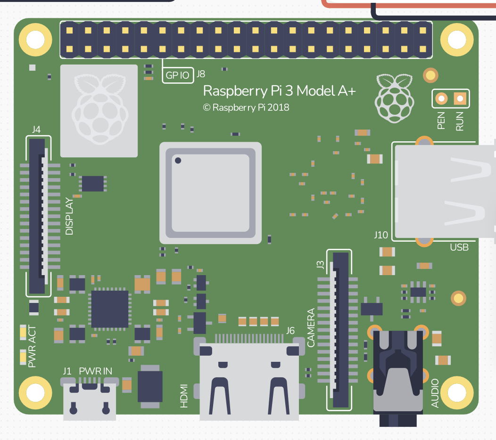

For some reason on the raspberry pi model, none of the pins are specific so I don't know which is is 3.3v.

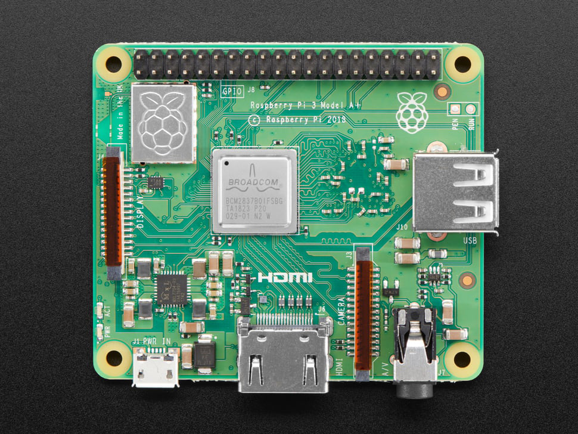

Even the real image does't have it labeled. I guess I'll have to watch a video to understand the board.

Found this very helpful video, now I understand.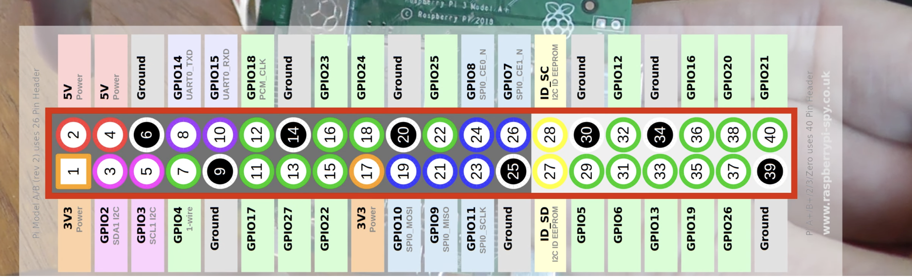

So pin 1 goes into sensor, etc.

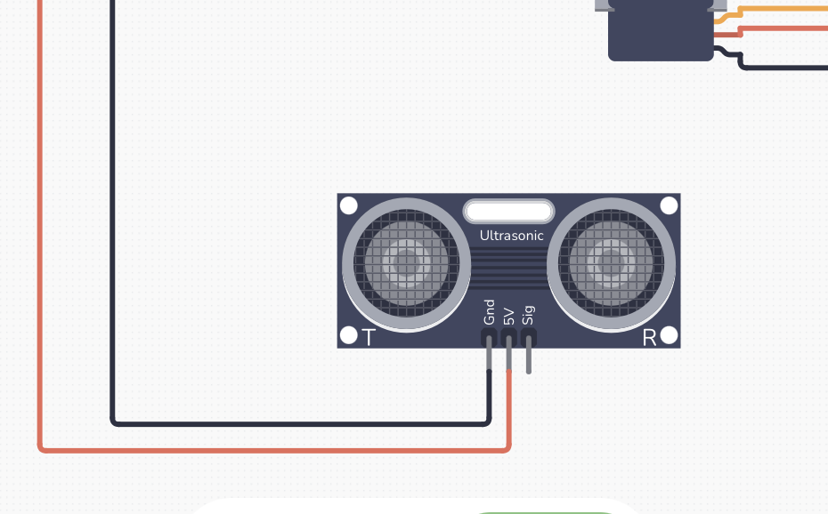

Hmm Hmm. I just noticed this sensor has 3 pins while the aliexpress one has 4

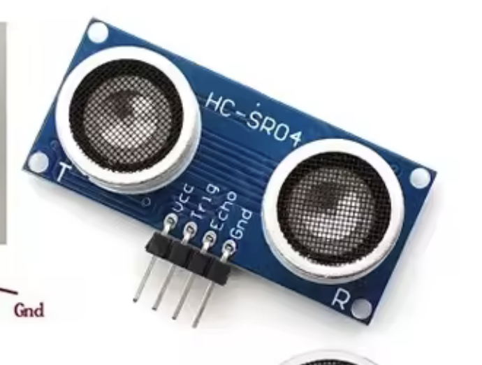

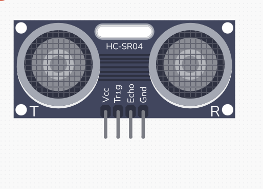

Ah, they have a 4 pin version too! I confirmed, so VCC is power, GND is just negative, trig is pin 16, and echo is pin 18.

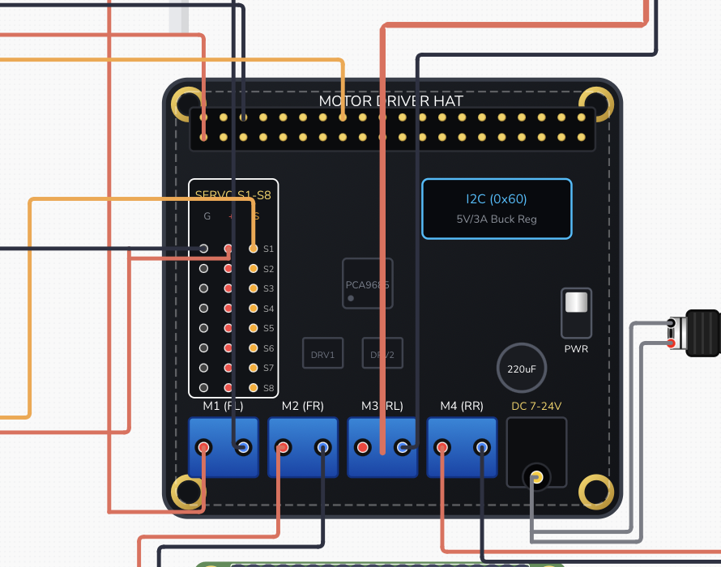

For some reason, any time I try to add a new wire to the hat another wire just disappears. Weird. Lemme refresh the page. Also I am aware my wiring is horrible. That wire is still disappearing. I'll just ignore that wire and wire it at the end.

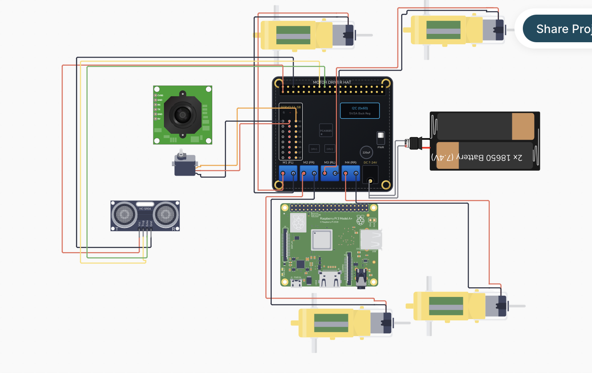

Okay everything is wired except for camera, because I think camera just has a ribbon cable that goes into Raspberry pi. Let me confirm this. Yes it does have a cable that goes into rasperry pi. So basically this diagram shows eveything, except for camera. And also the hat goes on top of the Pi, although I think that's pretty obvious. Ooh we can add arrows and text in this. That's cool!

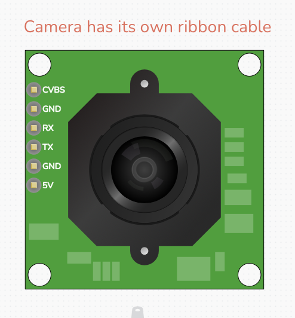

I wrote this.

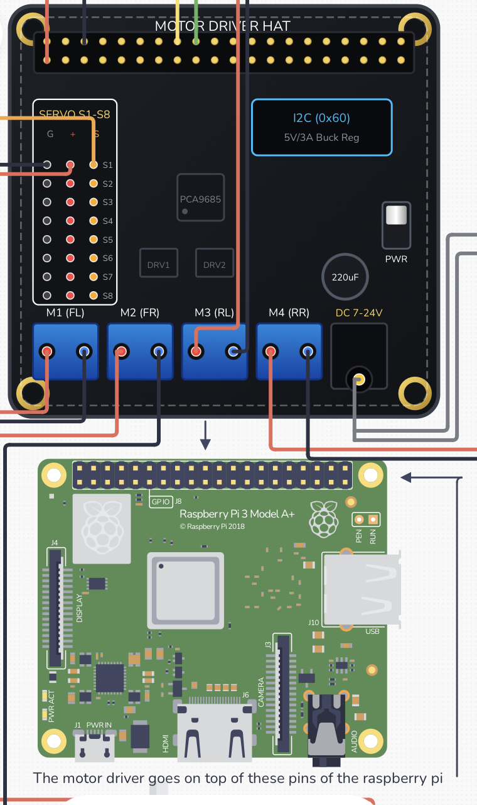

And hopefully this is clear enough.

Okay, so that concludes electronics. I exported it as .png and .svg, here's .png:

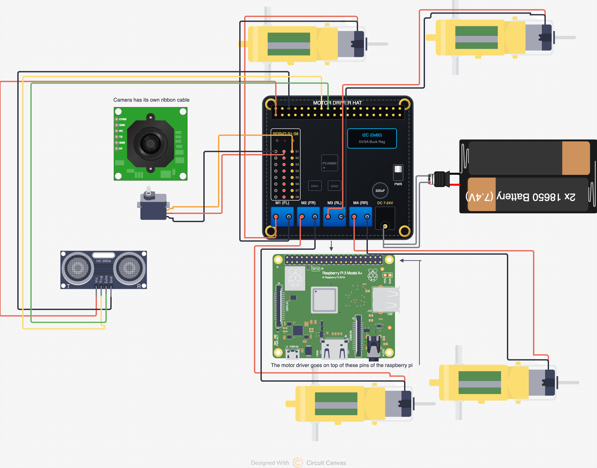

40 min checkpoint.

Now I can go on to code, or I can start to make the Github look presentable by working on READMes and a clear BOM. Eh, I'll go into the code. To approach this, I'll first watch the video of how someone coded their obstacle avoiding thing so I can get an idea of how it works.

Hmm it seems pretty complex. I'm going to download the code from the video and see. It's for the arduino so it's in C++ and if I'm not mistaken, the raspberry pi uses python. Oh wow, yeah raspberry pi is complex. Okay, so I'm going to focus on the tutorials for Raspberry Pi self driving cars. Wow it is very complex. WOW

I found this tutorial [https://www.youtube.com/watch?v=aXqoPiMPhDw](https://www.youtube.com/watch?v=aXqoPiMPhDw)

First I need to import python library. I will create a new folder here for that. Now I need to see how to import Open CV library. I just write import cv2. Ohh for the coding part I should just turn on Hackatime.
