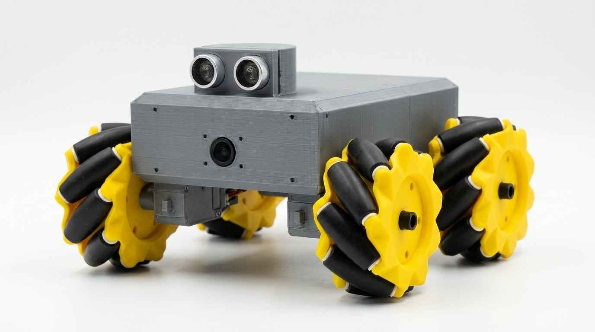
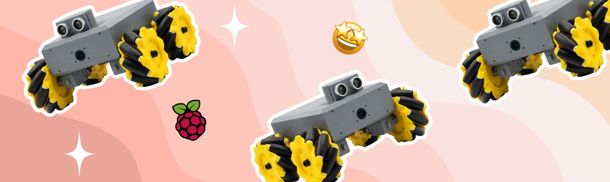
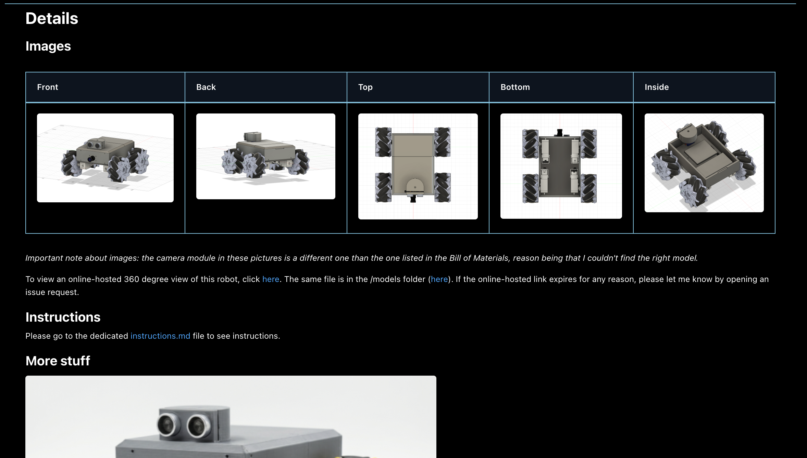
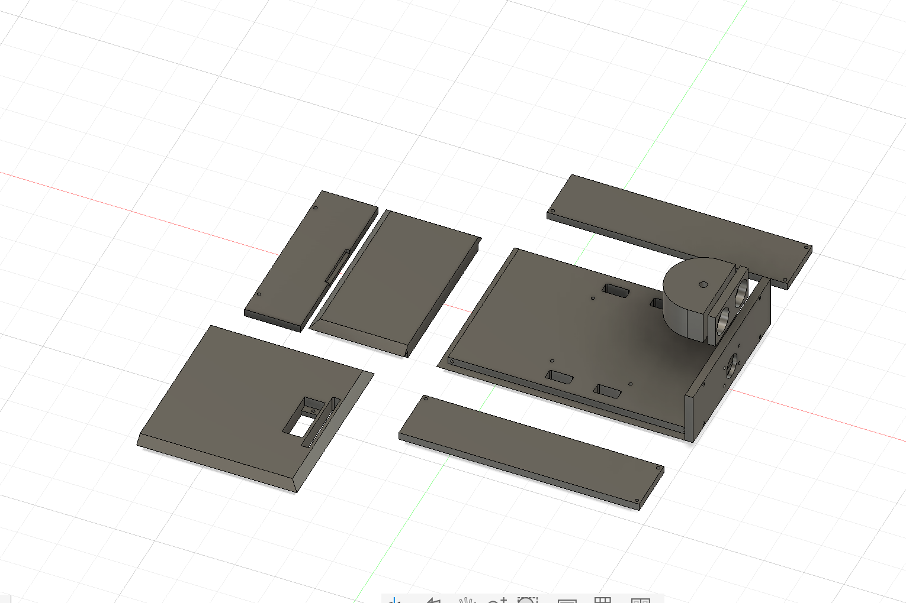
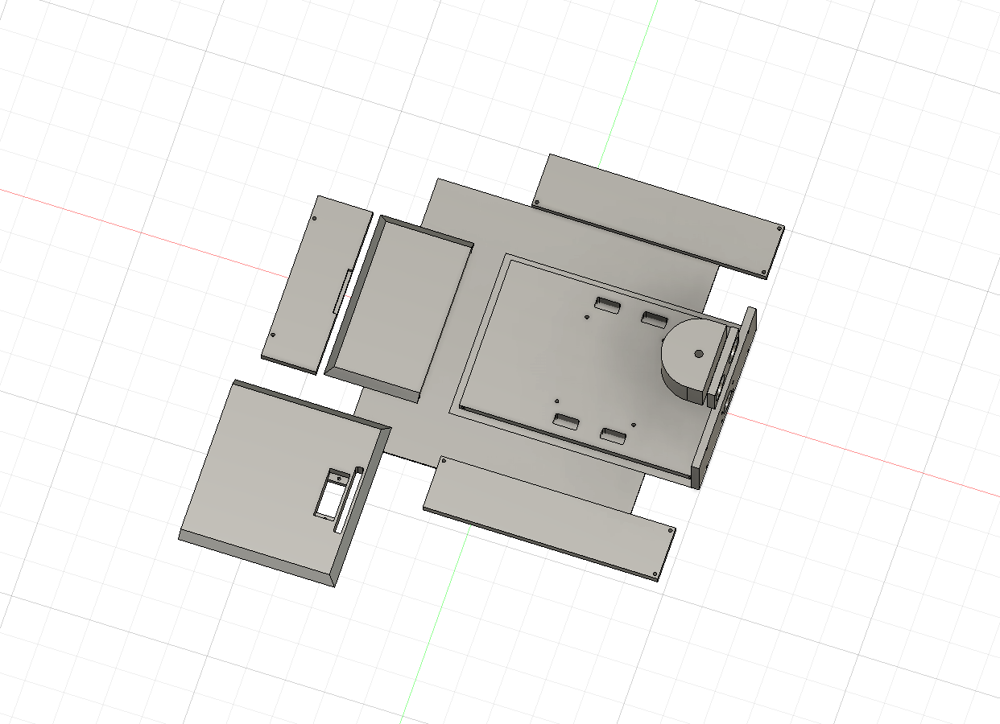
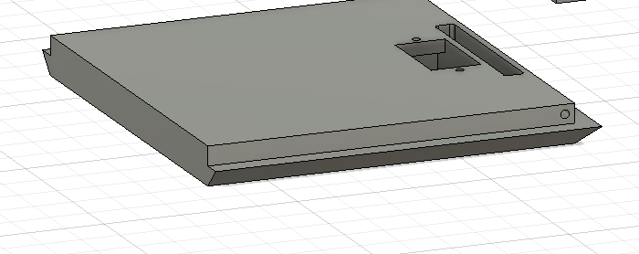
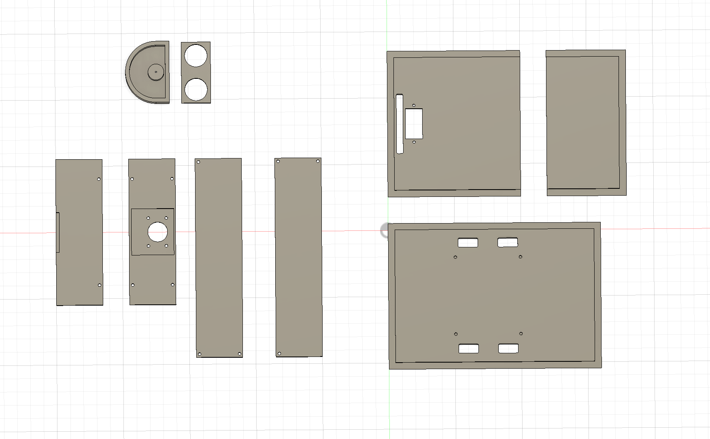

Today is it. Today I have completed everything for this rover, and I am going to now work on polishing the GitHub, adding BOM, and getting it ready to submit.   
I wrote the introduction and designed a cover image of Rover, what I did was use AI to transform a screenshot from Fusion 360 into what the final product should look like.

It looks pretty clean, I'm going to turn that into a poster for the Macondo website:

I used canva to make this, it shows the robot and the raspberry pi symbol to show what it does.

I've shelled out more of the repo now, and it's pretty developed now. I uploaded wiring diagram, hosted a 3D file, set up bill of materials. Now I will create the 3D printing models, and I will then work on instructions, although I except that I can't really make them detailed until I work with the actual parts, so the instructions will be basic for now.

Now I'm working on assembling the print files for the rover. I had to create a new hybrid project, then after getting stuck for a while, I figured that I could just save the file to the rover project, access the rover project's database, and import the original model into there. From there, I unliked the model, deleted all the parts that didn't need to be printed, and started laying out the parts properly. I wonder if I should make them separate files or not? I will find out by looking at the print bed size of the smalles printer I know (Bambu Lap A1 Mini) and creating a square with those dimensions. Then I can see how many separate files I'll need.

Bambu Lab A1 mini has print bed size of 180x180mm. Let's import that shape:

Ah, so that square is pretty small. But I get it. So I'm going to set up the components. Actually, should I just make each set separate? Yeah that'll be simpler, people an combine files together if they want to, but separating files would be more annoying for them.

I adjusted the orientation of the tapered parts to make it proper for 3d printing.

I setup similar parts together, and I'm not fully sure how projects usually have files for 3D printing. Let me search on that. Okay, actually it's fine to have everything on one file, so this is fine. Cool! So I will export this as .step and add to the models folder.
