Alright let's jump in. So I'm going to add some clearance to parts to help them fit. Specifically, I will add a 0.2 gap between the panels on the top because they're going to slide in and stay together.

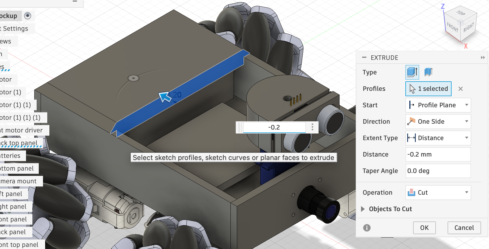

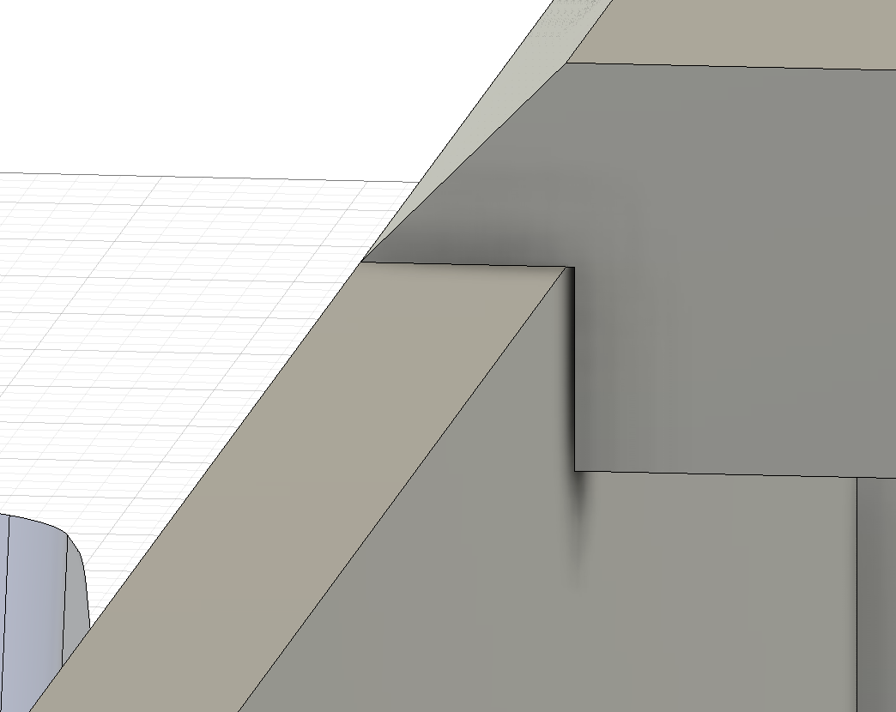

You can see the clearance here too (above).

Okay, now I also noticed one thing about the sensor mount that I can adjust. Specifically, the parts that is getting screwed on the servo can have the height of its inner column reduced to make the body of it sit lower.

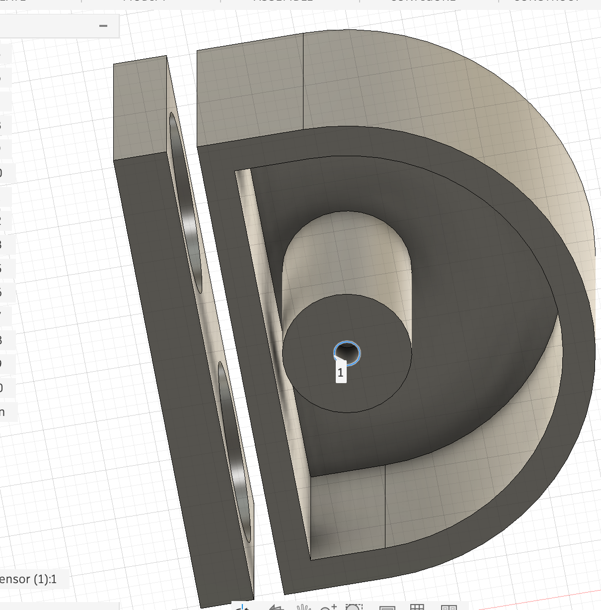

This specifically, it has a radius of 1.20mm for the inner hole.

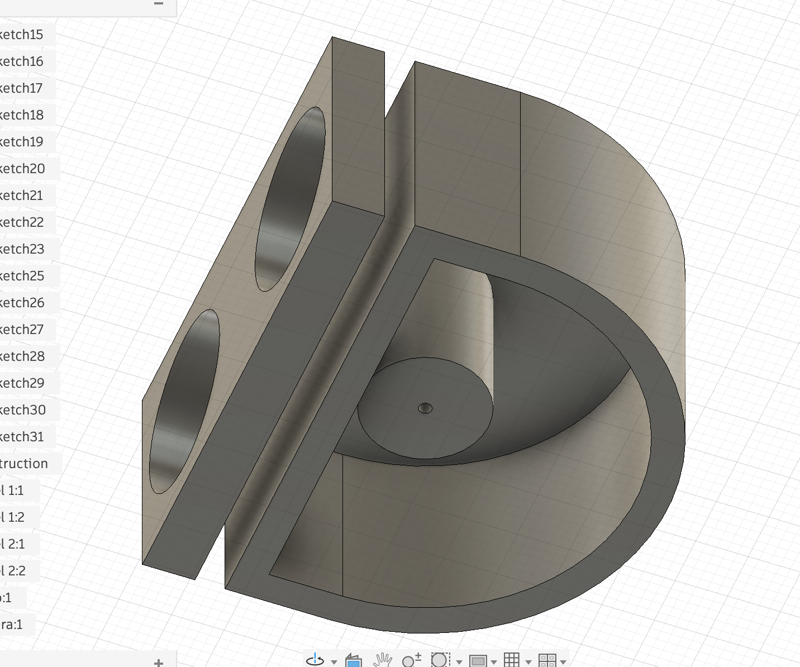

Now I have lowered the inner column 4mm which should let it sit lower on the motor.

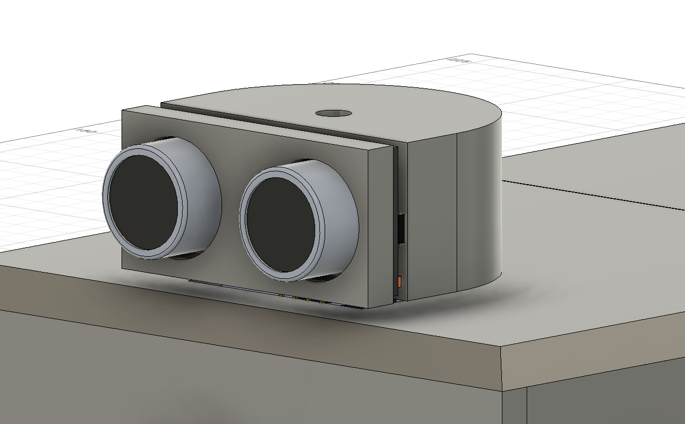

Now it sits a lot lower and looks cleaner. I also rotated the sensor 180 degrees because I realized it was upside down the whole time lol. Also I wonder if the eyes are the only things that need to be uncovered or if there's more parts. Let me see. Yeah that's fine. Okay, now I need to make a hole to let the cables from the sensor go into the body.

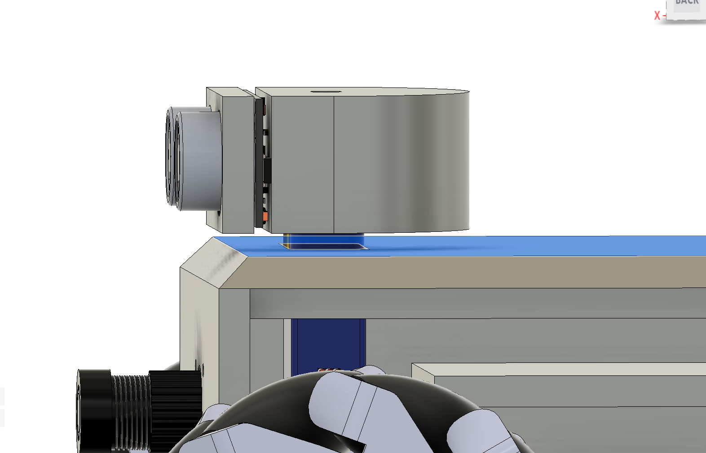

If I make a rectangular hole right under the sensor, I feel like the wires would restrict the motion of the sensor. So, I'm going to make a semicircle cut, two semicircles with different radiuses to make a U shape hole. Let's try that!

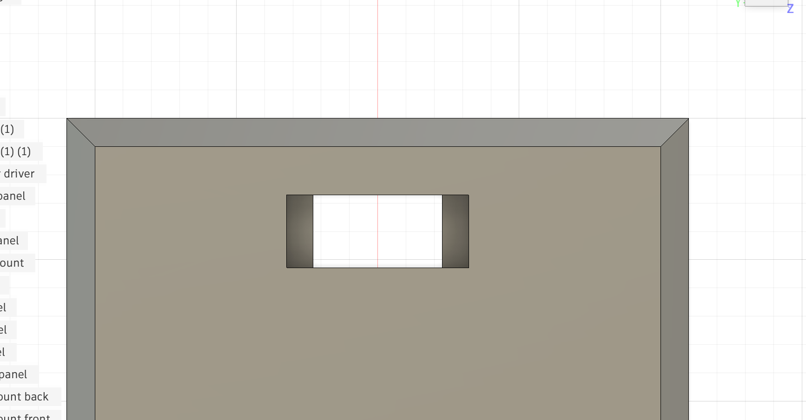

Actually looking at the top down view of the case, I think that the arc won't fit, so I'll just make a wide rectangle cut.

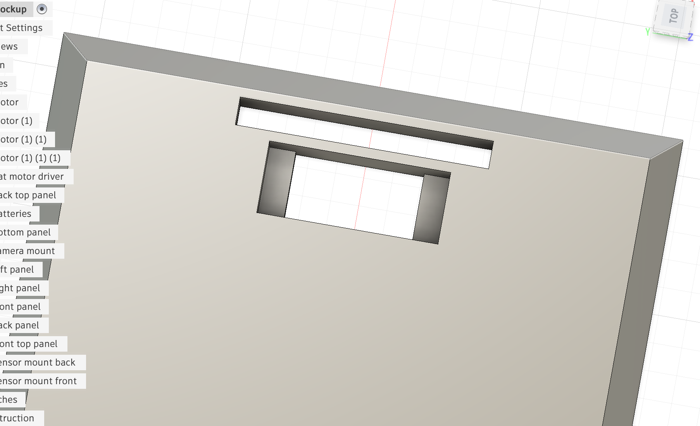

That should allow for some freedom in the wire movement but I'm not sure if it'll be enough. I think it should be. Now I'm going to make holes for the servo motor to mount.

According to guide, the holes are 27.7 mm apart. The holes themselves are 2mm so I'll make it a 2mm hole.

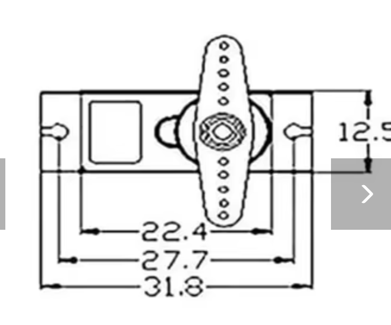

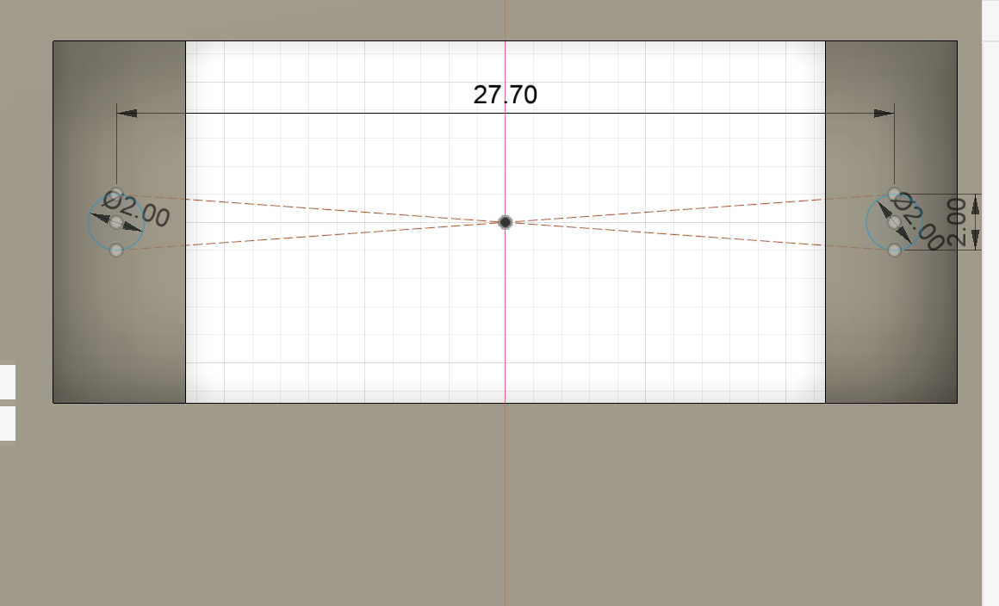

Cool!

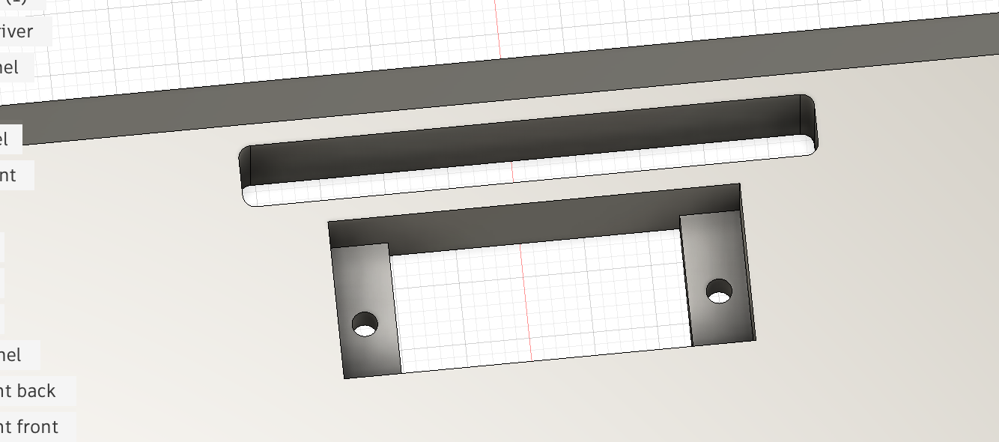

I added a bevel too to the top rectangle to make it look neat. Now I'm going to grab the list of holes to make from one of the past days (I don't remember which day it was). Ah yes day 7.

Here's it:

- Bottom panel hole for motors wires to go into board.
- Top panel holes for sensor wires to go into board. (Did that)
- Holes to connect panels together
- Holes for the camera mount (Did that)
- Holes for the servo motor mount (Did that.)
- Holes for raspberry pi mount
- Holes for battery holder mount
- {Later add-on - screw holes for motors to attach to the case}

Okay, so we'll start with the bottom panel hole for motor wires to go through.

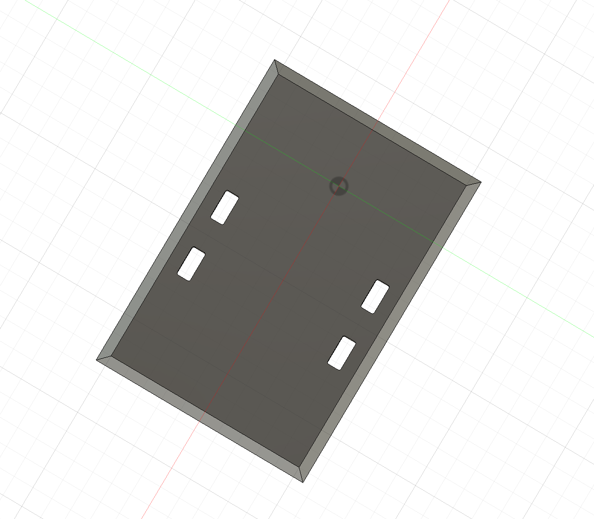

Okay so I cut the four holes, and added bevels to them to make them look nicer.

Next on the list is holes to connect panels together. Yay. I'll go with M2.5 screw holes, so I'll cut 2.2 mm holes. I'll make it for 12mm long screws ([https://www.aliexpress.us/item/3256808523663879.html](https://www.aliexpress.us/item/3256808523663879.html)).

Adding it to BOM:

1. 4 80mm mecanum wheels - [https://www.aliexpress.us/item/3256804929248374.html](https://www.aliexpress.us/item/3256804929248374.html)
2. 4 1:220 TT Motors - [https://www.aliexpress.us/item/3256808093084021.html](https://www.aliexpress.us/item/3256808093084021.html)
3. Ultrasonic sensor (3.3v compatible) - [https://www.aliexpress.us/item/3256812540803651.html](https://www.aliexpress.us/item/3256812540803651.html)
4. Raspberry Pi 3 Model A+ - [https://www.adafruit.com/product/4027](https://www.adafruit.com/product/4027)
5. DF Robot Motor Driver Expansion Board - [https://www.aliexpress.us/item/3256807075492551.html](https://www.aliexpress.us/item/3256807075492551.html) or [https://www.dfrobot.com/product-2851.html](https://www.dfrobot.com/product-2851.html)
6. 12 mm M2.5 standoffs (spacers) + M2.5 screws
7. Wide-lens camera module - [https://www.aliexpress.us/item/2251832482194239.html](https://www.aliexpress.us/item/2251832482194239.html) (color I 130)
8. SG90 servo motor (for lidar sensor) - [https://www.aliexpress.us/item/3256806097043668.html](https://www.aliexpress.us/item/3256806097043668.html)
9. 2x 18650 2000mah 3.7v batteries - [https://www.aliexpress.us/item/3256808975352962.html](https://www.aliexpress.us/item/3256808975352962.html)
10. 2x18650 Battery Storage Box 7.4V - [https://www.aliexpress.us/item/3256811664143308.html](https://www.aliexpress.us/item/3256811664143308.html)
11. M2.5 screw holes - [https://www.aliexpress.us/item/3256808523663879.html](https://www.aliexpress.us/item/3256808523663879.html) (m2.5 x 12mm and m2.5 x 6mm and m2) <-- I already have m2 screws that are 4mm long so that's fine for me

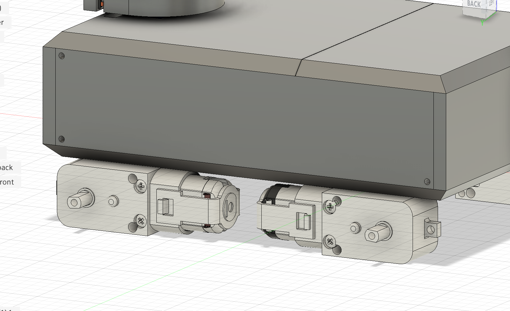

Okay I cut this side. But it's important to not have the top right corner screw hole because that part of the lid has to slide out. Speaking of, let me do something real quick before I forget again.

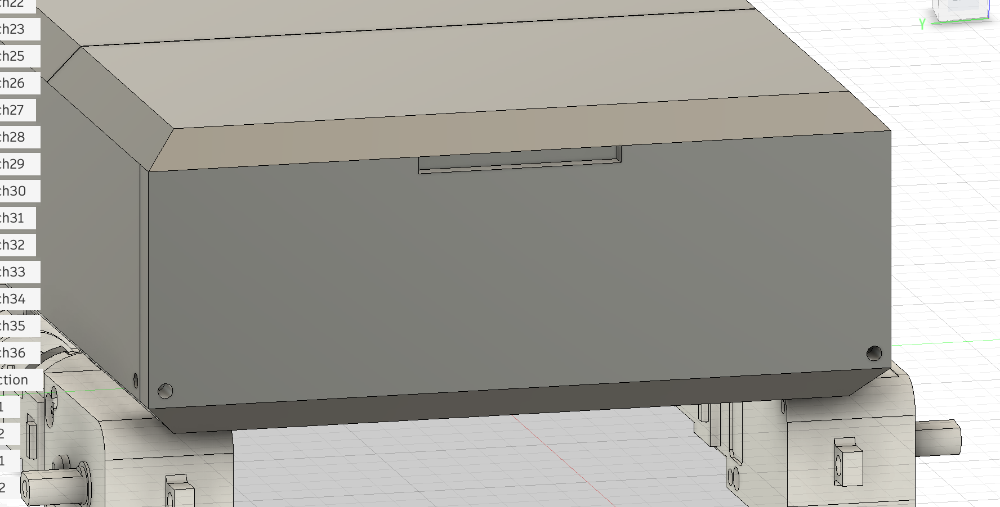

Okay so I cut the back holes, and the thing I was forgetting was to add a rectangular notch at the top to easily slide out the upper piece. Wait, I made the back screw holes in the wrong spot lol.

Fixed the holes, it's 15mm away from sides (the middle of the holes)

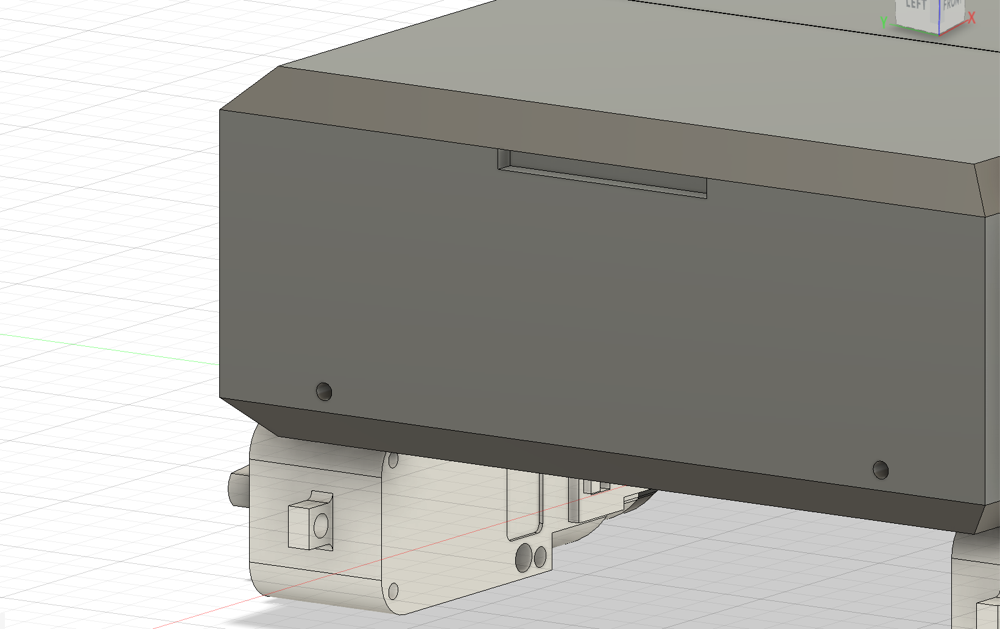

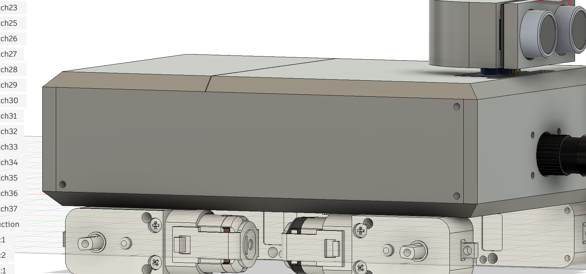

Cut this side now. (It looks like a tank lmao).

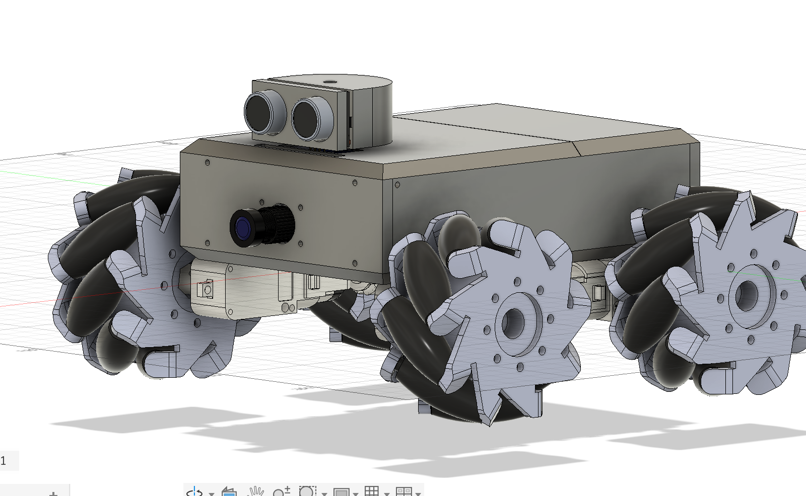

Okay all panels holes are cut.

Now for the raspberry pi and battery. For that, I was thinking to kust glue it/double side tape it to the bottom. This will allow me to adjust their positions if needed. Really, the battery case also doesn't have exact size measurements, so that's why for that. And for the raspberry pi, well I couuldd make the holes. Okay, I will. For the raspberry pi only.

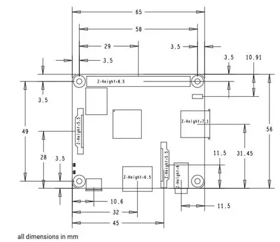

Okay, I found a nice picture. So what I need is that overall dimensions are 65x56 mm. The holes form an inner rectangle of 49x58mm. The dimameter of the holes is uhh 7mm? No way. Yeah, it's 2.75 mm (for use with M2.5 screws). So I'm going to make it 2.2 mm thick. I'll make the holes 5mm deep, so I'll get 6mm screws. Okay, updated BOM with that.

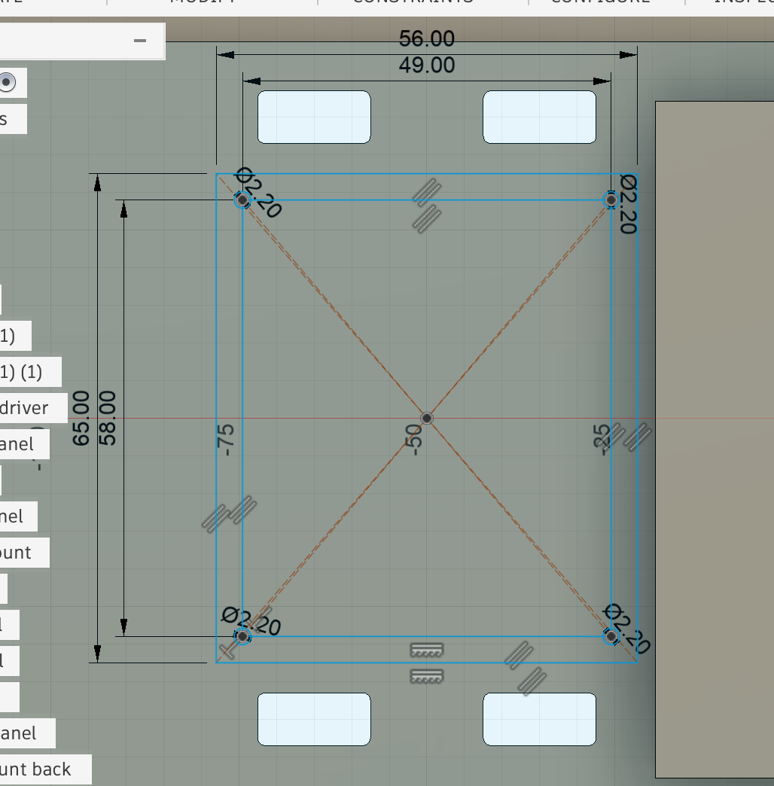

Neato.

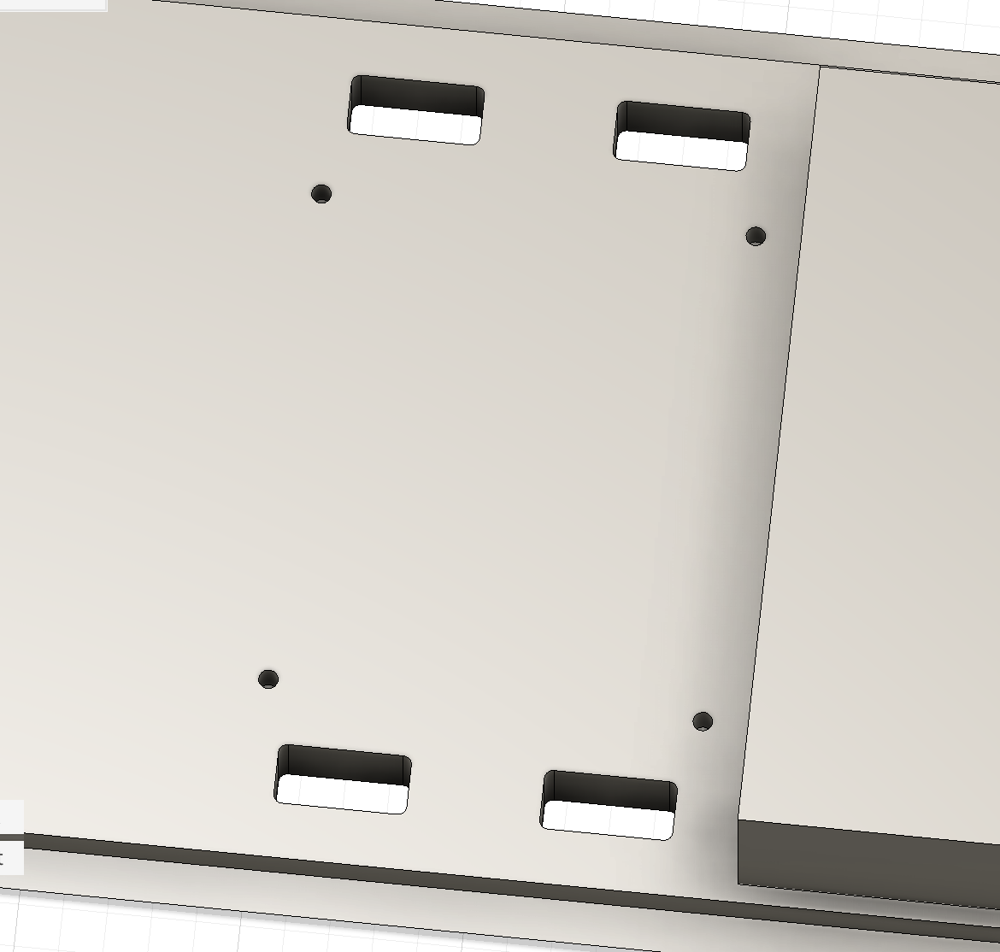

Wow! (Thing on the right is the battery).

Okay, now for mounting motors. I think they're usually just hot glued. But let's see. Oh I almost forgot to add the screws for servo motor to the BOM. Actually it's M2 and I already have M2, so I'll add it, but I won't put a link to it.

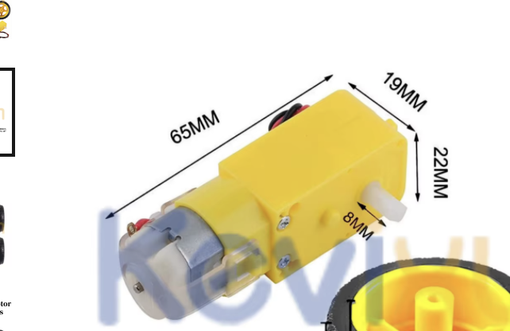

Yeah, they're really just flat. So hot glue it is.

Alright. So are we really done with the CAD? Really?

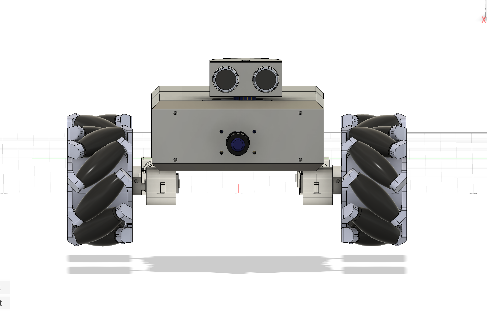

Huh, for some reason the motors and wheels need to be pushed in about 10.5mm.

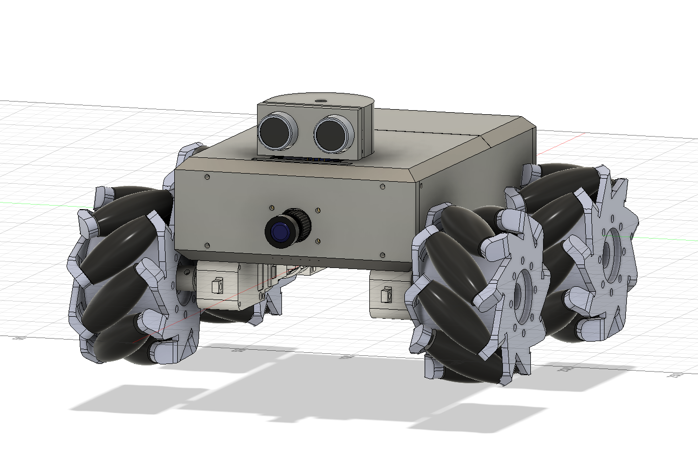

Alright, DONE. DONE. After 9 days, the chassis is complete. Something probably will come up later on and I'll hae to return to this, but boy I never though I could have assembled something as complex as this. If someone showed me this picture and said design it in fusion, I would give up. That's wild. Anyways, tomorrow we go to wiring!
